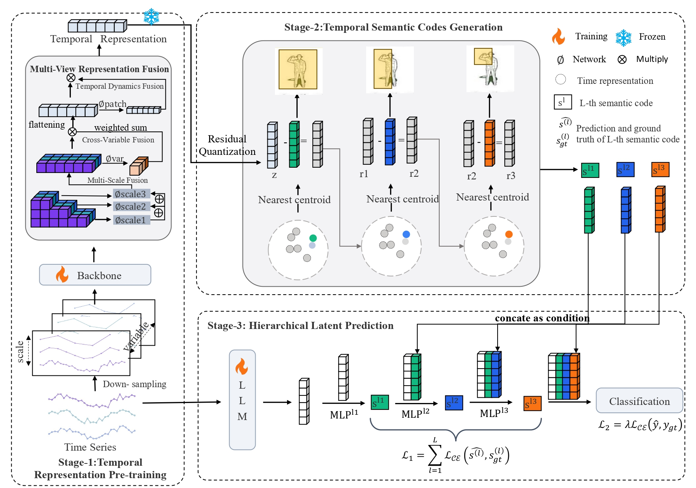

# [ICML 2026] Hi-Time: Hierarchical Latent Prediction for Multivariate Time Series Classification

## Overview

This repository contains the implementation code for *Hi-Time: Hierarchical Latent Prediction for Multivariate Time Series Classification*.

Integrating Large Language Models (LLMs) into time series tasks has yielded impressive performance. While some works aim to enhance accuracy by explicitly designing step-by-step reasoning into prompts, such explicit Chain-of-Thought (CoT) approaches are difficult to generalize to time series. This is because it is difficult to clearly define the reasoning trajectories of time series. In addition, the high heterogeneity across time series often requires specialized prompt designs, limiting the model's scalability.To address these challenges, we propose **Hi-Time**, a **hi**erarchical latent prediction framework based on temporal semantic codes for multivariate **time** series classification. This framework automatically constructs scenario-specific coarse-to-fine prediction trajectories based on the characteristics of time series, thereby providing structured supervision for the LLM.Specifically, Hi-Time first performs temporal representation pre-training with a multi-view temporal representation fusion to acquire high-quality temporal embeddings. We then discretize these temporal embeddings into hierarchical temporal semantic codes that form the coarse-to-fine prediction trajectory. Finally, the LLM predicts temporal semantic codes in a stepwise manner and then infers the final label, thereby establishing a coarse-to-fine decision process.Experiments on ten public multivariate time series datasets demonstrate that Hi-Time effectively adapts to diverse datasets and outperforms state-of-the-art methods.

## The Model Framework of Hi-Time



## Datasets

We follow the benchmark on [TS-GAC](https://github.com/Frank-Wang-oss/TS-GAC) and use 10 datasets: UCI-HAR, ISRUC-S3, and 8 UEA datasets including ArticularyWordRecognition (AWR), FingerMovements (FM), SpokenArabicDigits (SAD), CharacterTrajectories (CT), FaceDetection (FD), InsectWingbeat (IW), MotorImagery (MI), and SelfRegulationSCP1 (SRSCP1).

### UCI-HAR

You can access [here](https://archive.ics.uci.edu/ml/datasets/Human+Activity+Recognition+Using+Smartphones).

### ISRUC-S3

You can access [here](https://sleeptight.isr.uc.pt/), and download S3.

### UEA Datasets

You can access [here](http://timeseriesclassification.com/dataset.php).

This repository includes the FingerMovements dataset as a demo example. To use other datasets, download the corresponding `.npy` files and place them under `data/datasets/<DatasetName>/`:

```
data/datasets/<DatasetName>/
├── X_train.npy
├── y_train.npy
├── X_test.npy
└── y_test.npy
```

## Requirements

Use Python 3.9. The dependencies specify PyTorch 2.0.0 with CUDA 11.8 and Transformers 4.30.2.

```bash
python3.9 -m venv .venv
source .venv/bin/activate
pip install -r requirements.txt
```

### Pretrained GPT-2 Weights

Stage 3 requires pretrained GPT-2 small weights. Download them from [Hugging Face](https://huggingface.co/openai-community/gpt2) and place the files under `pretrained/gpt2/`:

```text
pretrained/gpt2/
├── config.json
└── model.safetensors
```

## Running the Code

All commands use the FingerMovements configuration in [configs/fingermovements.json](configs/fingermovements.json). Provide integer seed values through `--seed` or `--seeds`; replace the placeholders in the examples below.

### Training

Run the full three-stage pipeline with one seed:

```bash
python train.py --seed SEED --gpus 0
```

Run multiple seeds sequentially on one GPU:

```bash
python train.py --seeds SEED_1 SEED_2 SEED_3 SEED_4 SEED_5 --gpus 0
```

Run multiple seeds in parallel, with one task per GPU:

```bash
python train.py --seeds SEED_1 SEED_2 SEED_3 SEED_4 SEED_5 --gpus 0 1 2 3 4
```

### Available Arguments

| Argument | Default | Description |
| --- | --- | --- |
| `--config` | `configs/fingermovements.json` | Configuration file |
| `--seed` | Required unless `--seeds` is supplied | Seed for a single run |
| `--seeds` | Required unless `--seed` is supplied | Seeds for multiple runs |
| `--gpus` | `0` | GPU IDs; one concurrent task per GPU |
| `--output` | `outputs` | Output directory |
| `--threads` | `4` | CPU threads per task |

`--seed` and `--seeds` are mutually exclusive.
